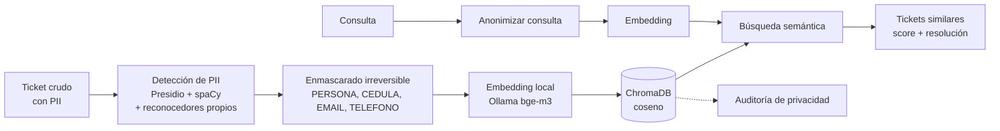

# Buscador semántico de tickets de soporte con anonimización previa de PII

Trabajo para la materia de Arquitectura de Software: ejemplo en código de una
solución que usa **datos anonimizados** y una **base de datos vectorial** a partir
de un caso de uso.

> Todo corre en la máquina local: sin Docker, sin servicios en la nube y sin
> internet una vez instalado. Ningún dato sale del equipo.

## Contenido

1. [Caso de uso](#caso-de-uso)
2. [Arquitectura](#arquitectura)
3. [Instalación en Windows (PowerShell)](#instalación-en-windows-powershell)
4. [Cómo ejecutar](#cómo-ejecutar)
5. [Resultados reales](#resultados-reales)
6. [Limitaciones](#limitaciones)
7. [Estructura del repositorio](#estructura-del-repositorio)

## Caso de uso

**Contexto.** La mesa de servicios de una universidad recibe tickets en español
sobre acceso y contraseñas, pagos, facturación, la app móvil, matrícula y soporte
técnico. Los estudiantes escriben como escriben: con su nombre, su cédula, su
correo y su celular dentro del mismo texto.

```
Saludos, soy Wilson Ruiz Pazmiño, estudiante de Derecho. La página de pagos no
acepta mi tarjeta, dice transacción declinada. Gracias de antemano. Wilson Ruiz
Pazmiño, CI 1825355777, wilson.ruiz52@example.net, 0999432627.
```

**Problema 1: encontrar casos parecidos ya resueltos.** Cuando llega un ticket
nuevo, el agente quiere ver cómo se resolvieron problemas similares. La búsqueda
por palabras clave falla porque las personas describen lo mismo con palabras
distintas:

| Ticket A | Ticket B |
|---|---|
| "No puedo entrar a mi cuenta, puse mal la clave tres veces" | "Se me bloqueó el acceso después de equivocarme con la contraseña" |

Casi no comparten palabras, pero significan lo mismo. Una **base de datos
vectorial** resuelve esto: cada ticket se convierte en un vector (embedding) que
representa su significado, y se buscan los vectores más cercanos por similitud
coseno.

**Problema 2: no se deben almacenar ni vectorizar datos personales.** Guardar el
texto crudo en la base vectorial replica la PII en otro sistema, y además el
embedding de un texto con PII también "contiene" esa PII (ver
[ataques de inversión](#limitaciones)). Por eso la solución **anonimiza antes de
generar embeddings y antes de guardar en la base**.

**Solución.**

```
ticket crudo -> detección de PII -> enmascarado irreversible -> embedding local -> ChromaDB -> búsqueda semántica
```

El mismo ticket, tal como queda guardado:

```
Saludos, soy [PERSONA], estudiante de Derecho. La página de pagos no acepta mi
tarjeta, dice transacción declinada. Gracias de antemano. [PERSONA], CI [CEDULA],
[EMAIL], [TELEFONO].
```

El agente pregunta "me cobraron dos veces la pensión" y obtiene los tickets más
parecidos con su resolución, sin que la base haya visto nunca un dato personal.
Si el agente pega en la consulta un ticket con PII, la consulta también se
anonimiza antes de vectorizarla.

### Actores y flujo

| Paso | Qué ocurre | Dónde |
|---|---|---|
| 1 | Llega un ticket con PII | Memoria |
| 2 | Presidio detecta nombres, cédulas, correos y teléfonos | `anonymizer.py` |
| 3 | Cada dato se reemplaza por una etiqueta fija, sin tabla de mapeo | `anonymizer.py` |
| 4 | Ollama (bge-m3) genera el vector del texto anonimizado | `embedder.py` |
| 5 | ChromaDB guarda vector, texto anonimizado y metadatos | `vectorstore.py`, `ingest.py` |
| 6 | El agente consulta; la consulta se anonimiza y se vectoriza | `search.py` |
| 7 | ChromaDB devuelve los k tickets más cercanos con su resolución | `search.py` |
| 8 | La auditoría verifica que nada guardado tenga PII | `audit.py` |

## Arquitectura



| Pieza | Tecnología | Por qué |
|---|---|---|
| Detección de PII | Presidio (analyzer + anonymizer) con spaCy `es_core_news_md` | Framework abierto de Microsoft para PII, extensible con reconocedores propios |
| Reconocedores propios | Cédula ecuatoriana (dígito verificador), teléfonos 09 y +593, correo, nombres con reglas de contexto | Presidio no trae reconocedores para Ecuador |
| Embeddings | Ollama local con `bge-m3` (multilingüe, 1024 dimensiones) | Buen desempeño en español y corre sin internet |
| Base vectorial | ChromaDB `PersistentClient`, métrica coseno | Embebida en Python, sin servidor ni Docker |
| Consola | `rich` | Salida legible para la exposición |

Detalle de componentes, qué se guarda en cada campo y decisiones de diseño:
[docs/arquitectura.md](docs/arquitectura.md).

## Instalación en Windows (PowerShell)

Requisitos: Windows 10/11, Python 3.10 o superior (probado con 3.11.9) y unos 3 GB
libres (modelo bge-m3 1.2 GB, modelo de spaCy y dependencias).

**1. Instalar Ollama** desde <https://ollama.com/download> o con winget:

```powershell
winget install Ollama.Ollama
```

Ollama queda corriendo en segundo plano. Verifica y descarga el modelo de
embeddings (cerca de 1.2 GB, una sola vez):

```powershell
ollama --version
ollama pull bge-m3
ollama list
```

**2. Clonar el repositorio:**

```powershell
git clone https://github.com/ricardofel/ejemplo-datos-anonimizados-y-bases-vectoriales.git
cd ejemplo-datos-anonimizados-y-bases-vectoriales
```

**3. Crear y activar el entorno virtual:**

```powershell
python -m venv .venv
Set-ExecutionPolicy -Scope Process -ExecutionPolicy Bypass
.\.venv\Scripts\Activate.ps1
```

`Set-ExecutionPolicy -Scope Process` solo afecta a la ventana actual y permite
ejecutar el script de activación. Si prefieres no activar el entorno, reemplaza
`python` por `.\.venv\Scripts\python.exe` en todos los comandos.

**4. Instalar dependencias** (incluye el modelo de spaCy en español):

```powershell
python -m pip install --upgrade pip
pip install -r requirements.txt
```

**5. (Opcional) Forzar UTF-8 en la consola.** Los scripts ya configuran UTF-8,
pero si ves caracteres raros en las tildes:

```powershell
[Console]::OutputEncoding = [System.Text.Encoding]::UTF8
$env:PYTHONUTF8 = "1"
```

**6. (Opcional) Regenerar el dataset sintético.** El CSV ya viene en el repo; el
script usa semilla fija y produce exactamente el mismo archivo:

```powershell
python scripts/generate_data.py
```

## Cómo ejecutar

Con el entorno activado y Ollama corriendo:

| Qué | Comando | Tiempo aprox. |
|---|---|---|
| Demo guiada (3 momentos) | `python demo.py` | 5 a 10 s |
| Demo para exponer (pausa entre momentos + casos difíciles) | `python demo.py --pausa --casos-dificiles` | a tu ritmo |
| Auditoría de privacidad de la base | `python scripts/audit_privacy.py` | 2 s |
| Auditoría sobre texto crudo (debe fallar) | `python scripts/audit_privacy.py --control-negativo` | 3 s |
| Evaluación recall@3 | `python scripts/evaluate.py` | 6 a 10 s |
| Tests | `python -m pytest` | 7 a 15 s |

La primera ejecución después de encender el equipo puede tardar unos segundos
más mientras Ollama carga bge-m3 en memoria.

**La demo muestra:**

1. **Momento 1:** el ticket crudo con la PII resaltada al lado del ticket
   anonimizado, y la tabla de entidades detectadas (tipo, detector y score).
2. **Momento 2:** la ingesta de los 90 tickets en ChromaDB con barra de progreso,
   el conteo final y cómo quedó guardado un registro (documento y metadatos).
3. **Momento 3:** tres consultas de ejemplo con los 3 tickets más similares, su
   score coseno, las palabras que comparten con la consulta y la resolución. La
   tercera consulta trae PII y se ve cómo se anonimiza antes de buscar.
4. **Extra (`--casos-dificiles`):** los casos donde el enmascarado falla.

**La auditoría** recorre todos los documentos, ids y metadatos de ChromaDB con
expresiones regulares independientes de Presidio. Termina con código 1 si
encuentra una cédula, un correo o un teléfono, y reporta como advertencia
patrones sospechosos que no puede confirmar (por ejemplo "x arroba y punto com").
Con `--control-negativo` audita una copia cruda en memoria para demostrar que sí
detecta la PII.

**Los tests** cubren la validación de cédula (casos válidos, provincia, tercer
dígito, verificador), la detección de cada tipo de PII, que el enmascarado no
deja PII en el dataset, que la auditoría aprueba lo anonimizado y reprueba lo
crudo, y que la búsqueda devuelve la categoría correcta en casos obvios. Los
tests de búsqueda se omiten si Ollama no está corriendo.

## Resultados reales

Salida de `python scripts/evaluate.py` con 15 consultas parafraseadas (escritas
evitando las palabras del ticket esperado) sobre los 90 tickets:

| Configuración | recall@3 | hit@3 escenario | MRR |
|---|---|---|---|
| Vectorial, texto crudo (con PII) | 0.87 | 0.93 | 0.750 |
| Vectorial, texto anonimizado (la solución) | 0.93 | 0.93 | 0.822 |
| Palabras clave, texto anonimizado | 0.60 | 1.00 | 0.404 |

- **recall@3:** proporción de consultas cuyo ticket esperado aparece en el top 3.
- **hit@3 escenario:** el top 3 trae al menos un ticket con la misma resolución
  (cada problema tiene 3 tickets redactados distinto).
- **MRR:** promedio de 1/posición del ticket esperado.

**Lectura honesta:**

- Anonimizar **no degradó** la búsqueda en este dataset. La diferencia a favor
  del texto anonimizado (+0.07) es **una sola consulta de 15**, así que no es
  una mejora significativa; una explicación plausible es que nombres y números
  agregan ruido al embedding.
- La búsqueda vectorial supera a palabras clave en recall@3 (+0.33) y MRR.
  Palabras clave tiene mejor hit@3 de escenario porque, con 3 tickets por
  problema, suele atinar a alguno del grupo aunque no al esperado.
- La consulta 5 ("¿puedo cancelar el semestre por partes, mes a mes?") falla en
  todas las configuraciones: en Ecuador "cancelar" significa pagar, y el modelo
  lo entiende como anular. Es un buen ejemplo de semántica regional.

Los números se calculan en cada corrida; si cambias el dataset o el modelo,
cambiarán.

## Limitaciones

**Anonimización vs seudonimización.** Seudonimizar es reemplazar el dato por un
código consistente (`PERSONA_17`) guardando aparte una tabla que permite
revertirlo; el dato sigue siendo personal. Anonimizar es que la persona ya no sea
identificable por medios razonables. Este proyecto reemplaza los
**identificadores directos** por etiquetas fijas sin tabla de mapeo, así que no
hay forma de revertirlo desde la base. Pero eso **no garantiza** que el conjunto
esté anonimizado en sentido estricto, por los cuasi-identificadores.

**Cuasi-identificadores.** Datos que solos no identifican, pero combinados sí:
"el decano de la Facultad de Ingeniería de la sede Loja" (TCK-0044) es una sola
persona y el sistema no lo enmascara. También la carrera ("estudiante de
Derecho"), la fecha del ticket o un problema muy específico pueden reducir el
grupo a pocas personas. Mitigaciones posibles: generalizar fechas a mes,
eliminar cargos y sedes, k-anonimato sobre metadatos.

**Ataques de inversión de embeddings.** Hay investigación que muestra que se
puede reconstruir buena parte del texto original a partir de su embedding (por
ejemplo Morris et al., 2023, "Text Embeddings Reveal (Almost) As Much As Text").
Por eso aquí el modelo **solo vectoriza texto ya anonimizado**: aunque alguien
invierta un vector, recuperaría `[PERSONA]` y no un nombre. Aun así, los vectores
deben protegerse igual que el texto.

**El enmascarado por reglas y NER no es perfecto.** Casos difíciles incluidos a
propósito en el dataset:

| Ticket | Caso | Resultado |
|---|---|---|
| TCK-0074 | Nombre en minúsculas ("hola soy gabriela ordóñez jaramillo") | Se enmascara |
| TCK-0013 | Apodo ("habla Panchito, el delegado del curso") | Se enmascara |
| TCK-0044 | Cuasi-identificador (el decano de la facultad de Loja) | **Falla:** queda en la base |
| TCK-0085 | Correo ofuscado ("wilson.moreno72 arroba example punto com") | **Falla:** queda en la base; la auditoría lo marca solo como advertencia |

Que el nombre en minúsculas y el apodo se detecten aquí no es garantía: dependen
del modelo de spaCy y de las reglas de contexto. Otros límites conocidos:

- El NER de spaCy solo no bastaba: tenía falsos positivos ("Gracias", "Pueden"),
  cortaba nombres y no detectaba nombres después de "Soy". Se agregaron reglas
  (ver [docs/arquitectura.md](docs/arquitectura.md)); otras redacciones pueden
  escaparse.
- Los teléfonos fijos sin prefijo +593 (por ejemplo "02 234 5678") no se detectan.
- Un celular 093 a 095 puede ser también una cédula válida de Guayas; en ese caso
  se etiqueta como `[CEDULA]`, pero igual se enmascara.
- No se detectan direcciones, placas, números de cuenta ni datos en imágenes o
  adjuntos.

**Dataset sintético.** Los 90 tickets se generan con plantillas (30 problemas x
3 redacciones). Nombres, cédulas, correos (dominios reservados `example.com`,
`example.org`, `example.net` y `.example`) y teléfonos son inventados; las
cédulas tienen dígito verificador válido y los teléfonos son aleatorios, así que
cualquier coincidencia con datos reales es accidental. Los tickets reales son más
desordenados (errores de tipeo, mezclas de temas, adjuntos), por lo que estos
resultados son optimistas. La evaluación usa solo 15 consultas: cada una vale
0.067 puntos de recall.

**El CSV contiene la PII sintética en crudo** a propósito, para poder demostrar
el enmascarado. En un sistema real el texto crudo debe tener su propia política
de retención y acceso.

**Contexto legal.** En Ecuador rige la Ley Orgánica de Protección de Datos
Personales (LOPDP, 2021), que regula el tratamiento de datos personales y
menciona la anonimización y la seudonimización. Se menciona solo como contexto:
**verificar el articulado vigente antes de citarlo** en la exposición.

## Estructura del repositorio

```
.
├── demo.py                      # demo guiada en 3 momentos
├── data/tickets_sinteticos.csv  # 90 tickets sintéticos (id, fecha, categoria, texto, resolucion)
├── docs/arquitectura.md         # diagrama y decisiones de diseño
├── scripts/
│   ├── generate_data.py         # genera el CSV con semilla fija
│   ├── audit_privacy.py         # auditoría de PII sobre ChromaDB
│   └── evaluate.py              # recall@3 crudo vs anonimizado vs palabras clave
├── src/ticketsearch/
│   ├── anonymizer.py            # Presidio + reconocedores para Ecuador
│   ├── embedder.py              # Ollama bge-m3
│   ├── vectorstore.py           # ChromaDB persistente, coseno
│   ├── ingest.py                # CSV -> anonimizar -> embedding -> ChromaDB
│   ├── search.py                # búsqueda semántica y línea base por palabras clave
│   ├── audit.py                 # reglas de la auditoría
│   ├── config.py                # rutas, modelo y host local
│   └── console.py               # UTF-8 en consola de Windows
├── tests/                       # pytest
├── requirements.txt             # versiones fijadas
└── LICENSE                      # MIT
```

La carpeta `chroma_db/` se crea al correr la demo y está en `.gitignore`.

## Licencia

MIT. Ver [LICENSE](LICENSE).
