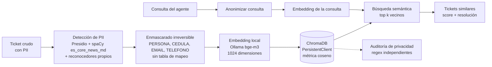

# Arquitectura

## Pipeline

El texto crudo solo existe en memoria entre los pasos A y C. A partir de C todo
lo que se procesa o se guarda ya está anonimizado.

## Componentes

| Módulo | Responsabilidad |
|---|---|
| `src/ticketsearch/anonymizer.py` | Presidio configurado para español de Ecuador. Reconocedores: `SpanishPersonRecognizer` (NER de spaCy + reglas), `EcuadorCedulaRecognizer` (10 dígitos, provincia 01-24, tercer dígito 0-5, dígito verificador módulo 10), `EcuadorPhoneRecognizer` (09xxxxxxxx y +593), `EmailRecognizer`. Reemplazo por etiquetas fijas. |
| `src/ticketsearch/embedder.py` | Cliente oficial `ollama` apuntando a `127.0.0.1:11434`, modelo `bge-m3`, lotes de 32. |
| `src/ticketsearch/vectorstore.py` | `chromadb.PersistentClient` en `chroma_db/`, colección con `space = cosine`, sin función de embedding propia y sin telemetría. |
| `src/ticketsearch/ingest.py` | CSV -> anonimizar texto y resolución -> embedding -> `upsert` en ChromaDB. |
| `src/ticketsearch/search.py` | Anonimiza la consulta, la vectoriza y busca los k vecinos. Incluye una línea base por palabras clave para comparar. |
| `src/ticketsearch/audit.py` | Revisa todos los documentos, ids y metadatos guardados con expresiones regulares independientes de Presidio. |

## Qué se guarda en ChromaDB

| Campo | Ejemplo | ¿Contiene PII? |
|---|---|---|
| `id` | `TCK-0003` | No (identificador interno sintético) |
| `document` | `Saludos, soy [PERSONA], estudiante de Derecho. La página de pagos no acepta mi tarjeta...` | No (anonimizado) |
| `embedding` | vector de 1024 números | Se calcula sobre el texto anonimizado |
| `metadata.categoria` | `pagos` | No |
| `metadata.fecha` | `2026-08-02` | Cuasi-identificador débil (ver Limitaciones del README) |
| `metadata.resolucion` | `El banco emisor bloqueaba compras en línea...` | No (también pasa por el anonimizador) |
| `metadata.pii_enmascaradas` | `5` | No, solo un conteo |

No se guarda: el texto crudo, los valores detectados, ni una tabla que relacione
etiquetas con valores originales. Por eso el enmascarado no se puede revertir
desde la base.

## Decisiones de diseño

1. **Anonimizar antes de vectorizar.** Un embedding del texto crudo también
   codifica la PII (ver ataques de inversión en el README), así que el modelo
   de embeddings nunca recibe datos personales.
2. **Todo local.** Ollama en `127.0.0.1`, ChromaDB en disco, spaCy instalado como
   paquete. No se cargan los reconocedores por defecto de Presidio porque
   algunos usan `tldextract`, que puede intentar descargar listas desde internet.
   La colección se crea con `embedding_function=None` para que Chroma nunca
   descargue su modelo por defecto.
3. **Reconocedor de personas propio.** Medimos el NER de spaCy sobre el dataset y
   encontramos tres problemas: falsos positivos ("Gracias", "Pueden", "hola"),
   nombres cortados ("Wilson" quedaba fuera de "Ruiz Pazmiño") y nombres
   escapados después de "Soy". Se resolvió con reglas sobre las etiquetas
   gramaticales de spaCy (nombres propios contiguos) y palabras de contexto
   ("soy", "me llamo", "mi nombre es", "les escribe", "habla").
4. **Solapamientos.** Una cédula de Guayas empieza con 09 y calza también como
   celular. La cédula validada por dígito verificador obtiene score 1.0 y gana.
5. **Defensa en profundidad.** La auditoría usa expresiones regulares propias,
   no Presidio, para no heredar sus mismos puntos ciegos.
6. **Evaluación en memoria.** El índice con texto crudo que usa
   `scripts/evaluate.py` vive en un `EphemeralClient` y se descarta al terminar.
